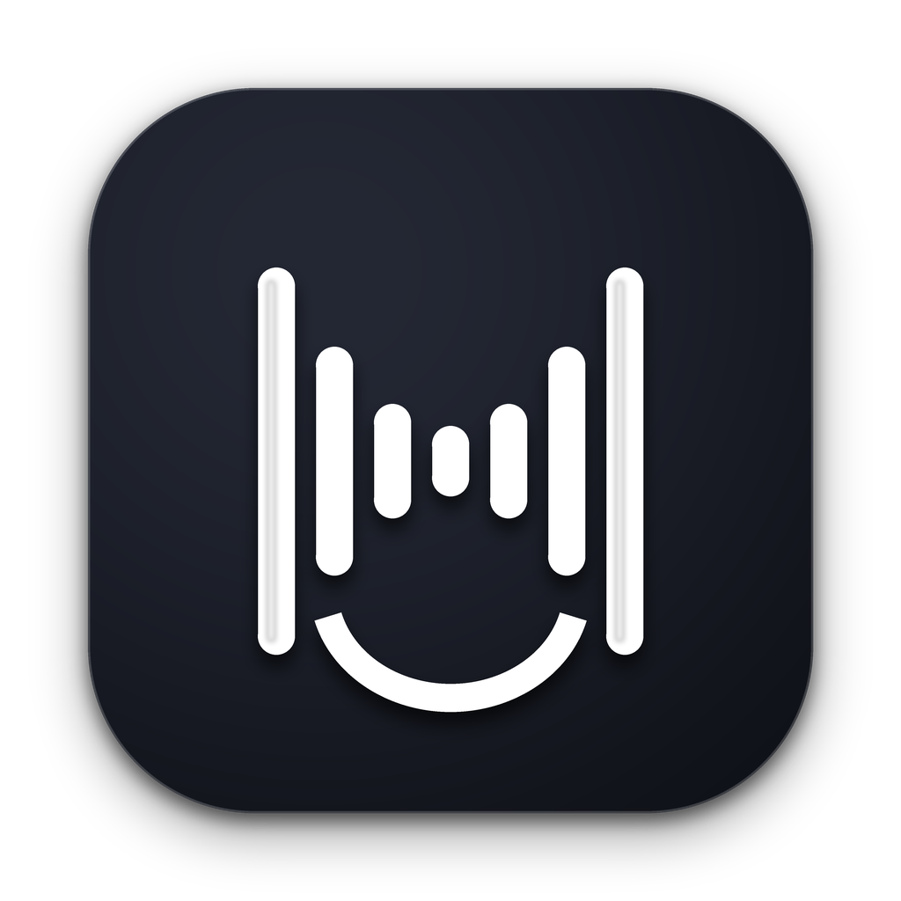
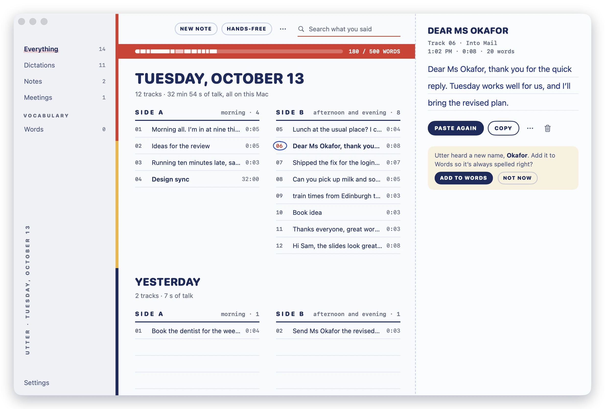
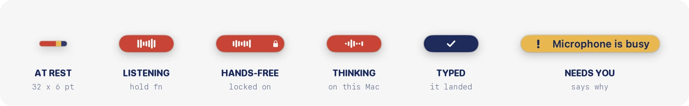
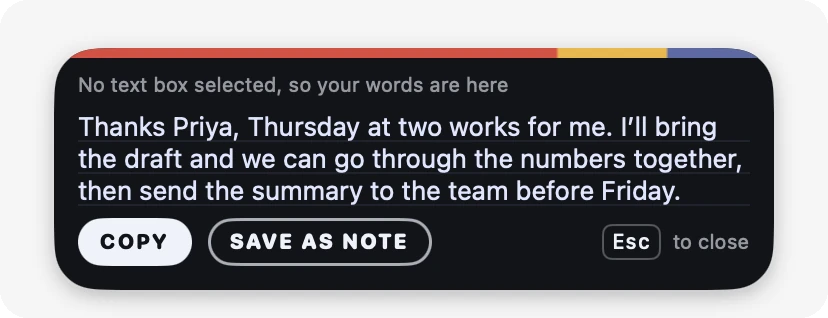
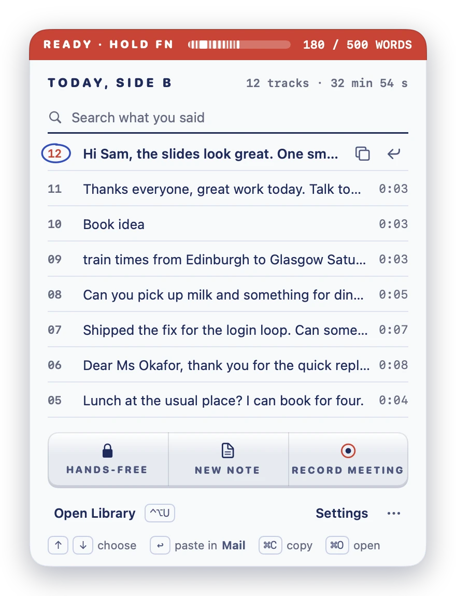
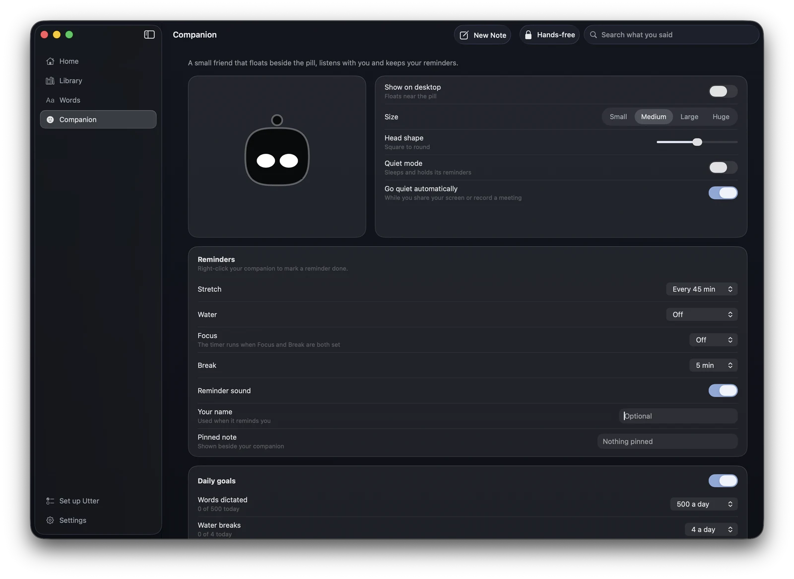
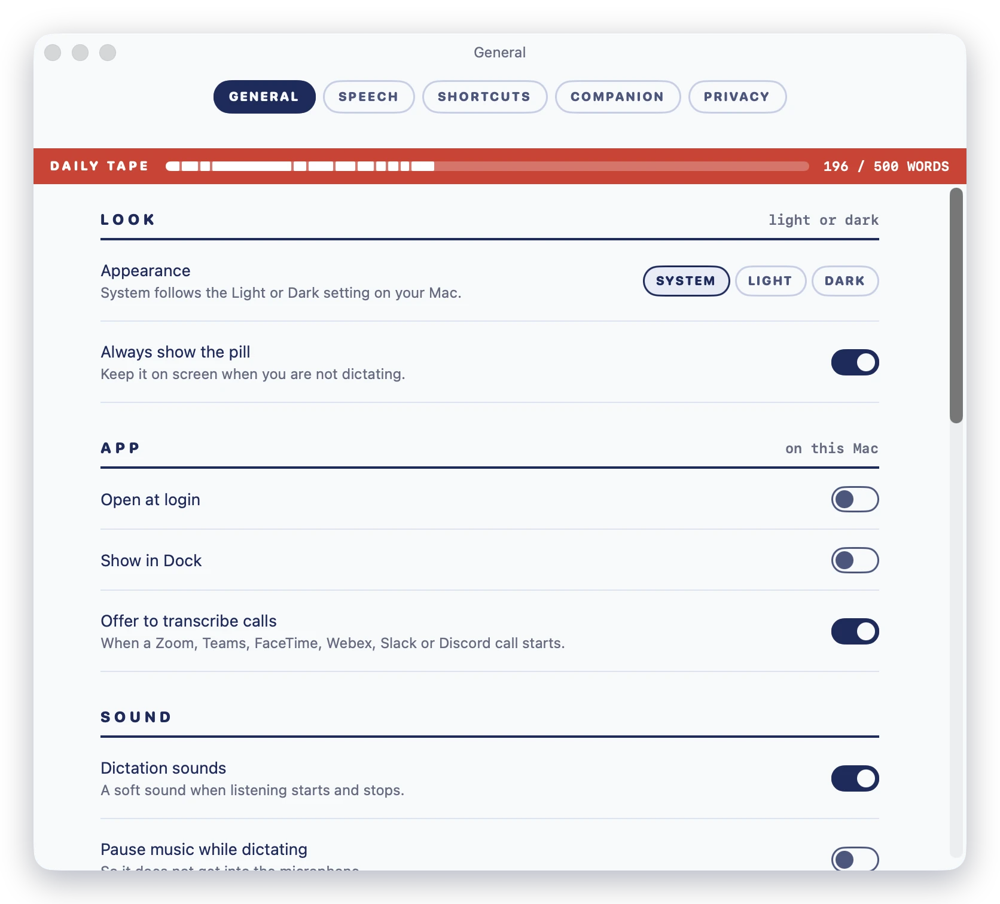
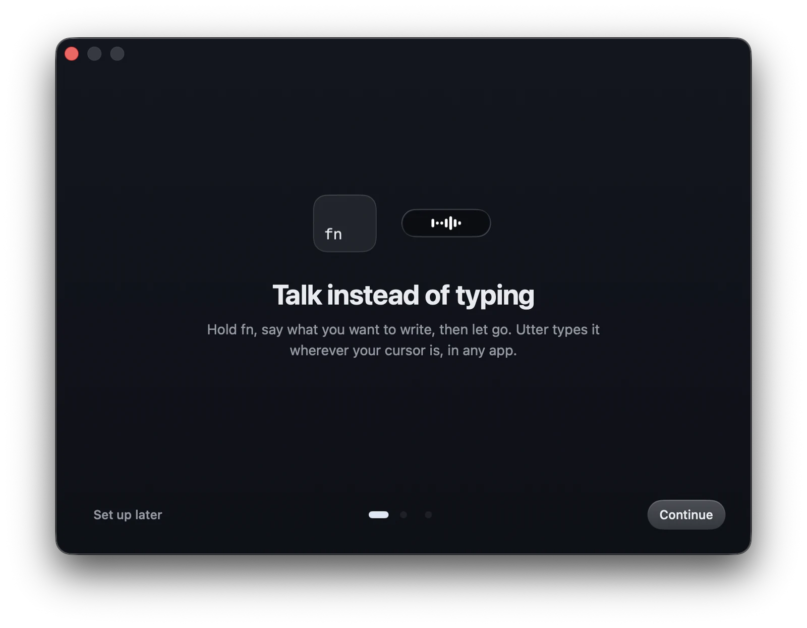

<div align="center">



# Utter

**Voice dictation for the Mac that never leaves the Mac.**

Hold a key, say it, let go. Your words appear wherever the cursor is.<br />
The speech model runs on your Mac, so it works offline, with no account and no subscription.

<a href="https://github.com/h3x-levi/Utter/releases/download/v1.2.0/Utter-1.2.0.dmg"></a>
&nbsp;
<a href="https://utter-eight.vercel.app/"></a>

<sub>macOS 14 or later · Apple silicon and Intel · 192 MB, speech model included · <a href="https://github.com/h3x-levi/Utter/releases">All releases</a> · <a href="https://utter-eight.vercel.app/">Official Website</a></sub>

[](https://utter-eight.vercel.app/)
[](LICENSE)
[](PRIVACY.md)
[](#contributing)

<br />

<video src="promo/Utter-Hype-16x9.mp4" controls="controls" width="100%" playsinline>
  <source src="promo/Utter-Hype-16x9.mp4" type="video/mp4" />
</video>

<p align="center">
  🎬 <strong><a href="promo/Utter-Hype-16x9.mp4">Watch the Utter promo video (16:9 Landscape)</a></strong>
</p>

<br />

<picture>
  <source media="(prefers-color-scheme: dark)" srcset="Assets/screenshots/library-dark.webp" />
  
</picture>

</div>

---

## How it works

1. **Hold `fn`** in any app: Mail, Slack, Notes, Xcode, a terminal, a browser.
2. **Talk.** The pill at the bottom of the screen turns red and shows it's listening.
3. **Let go.** Utter turns your speech into text on your Mac and types it at the cursor.

Double-tap `fn` to keep listening hands-free, and press `Esc` to cancel.

<p align="center">
  
</p>

At rest the pill is a 32 by 6 point stripe. It only grows while you talk.

If no text box was selected when you finished, your words wait in the island, so nothing you said is lost. Copy them, or save them as a note.

<p align="center">
  
</p>

---

## Local-first by design

Utter was built to keep your voice on your Mac. This is how the code behaves out of the box:

| | |
| :--- | :--- |
| **Where speech becomes text** | In the Utter process on your Mac, with [whisper.cpp](https://github.com/ggml-org/whisper.cpp) (or the optional Whistle engine). Audio is never uploaded. |
| **When it goes online** | Only when you choose to download another speech model. The model that ships in the app works with Wi-Fi off. |
| **Accounts and tracking** | None. No sign-in, no analytics, no telemetry. |
| **Where your data lives** | Plain JSON files in `~/Library/Application Support/Utter`, a folder only your user account can read. Delete it and everything is gone. |
| **Cost** | Free and open source under Apache 2.0. |

Read [PRIVACY.md](PRIVACY.md) for the details.

---

## What's inside

### The menu bar: today's tape, one click away

<table>
<tr>
<td width="52%">

Click the Utter icon in the menu bar to see today's tracks, newest first.

- **`↩`** types a track again into the app you were just in.
- **`⌘C`** copies it, and **`⌘O`** opens it in the Library.
- Search looks through every day, note and meeting.
- Start hands-free, a new note or a meeting recording from the keys underneath.

The red stripe across the top fills up as you talk toward your daily word goal.

</td>
<td width="48%" align="center">



</td>
</tr>
</table>

### Library: every dictation, note and meeting

Each day is a tape. Morning tracks go on Side A and the afternoon and evening on Side B, each with its running time. Pick a track and it opens on the right, where you can paste it again, copy it, turn it into a note or delete it. Deleting can be undone.

Dictate straight into a note with `⌃⌥N`. When a Zoom, Teams, FaceTime, Webex, Slack or Discord call starts, Utter can offer to transcribe it. It records your microphone and the call audio and labels the two sides **You** and **Others**, all on your Mac.

### Words: teach it your vocabulary

- **Dictionary:** names and terms Utter should always spell your way, such as colleagues, products and jargon. When Utter hears a new name, it offers to add it.
- **Snippets:** say a short phrase and it expands into longer text, with `[date]`, `[time]`, `[day]` and `[clipboard]` filled in when it expands.
- **Voice commands:** select text in any app and say what to do with it ("make this shorter", "fix the punctuation"). On Macs with Apple Intelligence these run on the on-device model.

### Companion: a small friend beside the pill

An optional robot that floats near the pill, listens along with you, and sleeps when you're idle. It can remind you to stretch, drink water or take a break, and keep private reminders you speak with `⌃⌥R`. It goes quiet by itself while you share your screen or record a meeting. Turn it on in Settings → Companion.



### Two speech engines

| Engine | Best for | Size |
| :--- | :--- | :--- |
| **Accurate** (Whisper small.en, included) | Everyday dictation with the best results | 190 MB |
| **Fast** ([Whistle](https://cactuscompute.com/blog/whistle), included) | Text that appears instantly; Apple silicon on macOS 26 | 17 MB |

In Settings → Speech you can switch engines, or download larger Whisper models, including multilingual ones.



### Made for macOS

Utter is a native Swift app, designed like a cassette J-card: white ruled card, navy ink, and a red stripe for today's tape. In Dark mode it becomes chrome tape. It lives in the menu bar and stays out of the Dock unless you ask for it there.

---

## Keyboard shortcuts

**Anywhere**

| Shortcut | What it does |
| :--- | :--- |
| Hold **`fn`** (or Right `⌥`, Right `⌘`, Right `⌃`) | Dictate into the app you're using |
| Double-tap **`fn`**, or **`⌃⌥Space`** | Hands-free: keep listening until you stop |
| **`⌃⌥N`** | Dictate into a new Utter note |
| **`⌃⌥R`** | Tell your companion a private reminder |
| **`⌃⌥U`** | Open the Library |
| **`Esc`** | Cancel |

You can change the dictation key in Settings → Shortcuts.

**In the menu-bar hub**

| Shortcut | What it does |
| :--- | :--- |
| **`↑`** **`↓`** | Choose a track |
| **`↩`** | Type it again into the app you were in (opens a meeting instead) |
| **`⌘C`** | Copy it |
| **`⌘O`** | Open it in the Library |
| **`⌘N`** | New note |
| **`⌘,`** | Settings |

**In the Library**

| Shortcut | What it does |
| :--- | :--- |
| **`↑`** **`↓`** | Choose a track |
| **`↩`** | Paste a dictation again |
| **`⌘C`** | Copy the track |
| **`⌫`** or **`⌘⌫`** | Delete the track |
| **`⌘Z`** | Undo the delete |
| **`⌘N`** | New note |
| **`⌘F`** | Search |
| **`⌘1`** to **`⌘4`** | Everything, Dictations, Notes, Meetings |
| **`⌘5`** | Words |

---

## Install

1. **[Download Utter-1.2.0.dmg](https://github.com/h3x-levi/Utter/releases/download/v1.2.0/Utter-1.2.0.dmg)** and open it.
2. Drag **Utter** into **Applications**.
3. Open Utter. Setup asks for two permissions:
   - **Microphone**, to hear you.
   - **Accessibility**, to notice the `fn` key and type into other apps.



> [!NOTE]
> Utter is signed but not notarized, because notarization needs a paid Apple developer account. The first time you open a downloaded copy, macOS says it can't verify the app. Go to **System Settings → Privacy & Security** and click **Open Anyway**. [Installing on another Mac](docs/INSTALLING-ON-ANOTHER-MAC.md) has the details.

---

## Build it yourself

You need macOS 26 with Xcode 26 or its Command Line Tools, because the app uses the macOS 26 SDK. The app itself runs on macOS 14 and later.

```bash
git clone https://github.com/h3x-levi/Utter.git
cd Utter
swift build                                  # compile
swift test                                   # run the test suite
bash scripts/build-app.sh --no-dmg           # make build/Utter.app
bash scripts/build-app.sh --version=1.2.0    # make build/Utter-1.2.0.dmg too
```

To try a build without touching your own notes and history, point it at a throwaway folder:

```bash
open --env UTTER_DATA_DIR=/tmp/utter-dev build/Utter.app --args --open-window
```

---

## Contributing

Utter is a community project and contributions are welcome, whether code, design, bug reports or docs.

- **Found a bug?** [Open an issue](https://github.com/h3x-levi/Utter/issues/new). Include your macOS version, Mac model and microphone. Settings → General → Report an Issue fills most of this in for you.
- **Want to build something?** Open an issue first for anything large so we can agree on the shape, then send a pull request.
- **Before you start,** read [CONTRIBUTING.md](CONTRIBUTING.md). Above all, never log or upload audio, transcripts or anything the user typed.

How the code is laid out:

| Folder | What lives there |
| :--- | :--- |
| `Sources/UtterCore` | Audio, speech engines, storage, the dictation pipeline. No UI. |
| `Sources/UtterKit` | Every window and view: pill, island, menu-bar hub, Library, Words, Settings and the companion. |
| `Sources/Utter` | The app's entry point. |
| `Tests/UtterKitTests` | The test suite. `UTTER_SCREEN_SNAPSHOTS=1 swift test` also renders every screen to `.build/screen-snapshots/`. |

---

## Credits

- [whisper.cpp](https://github.com/ggml-org/whisper.cpp) (MIT) for the Accurate engine.
- [Whistle](https://cactuscompute.com/blog/whistle) by Cactus Compute (Apache 2.0) for the Fast engine.
- The companion robot is a native port of a design by CX-ArtLab (MIT).

Full notices are in [THIRD_PARTY_NOTICES.md](THIRD_PARTY_NOTICES.md).

## License

Apache License 2.0. See [LICENSE](LICENSE).
