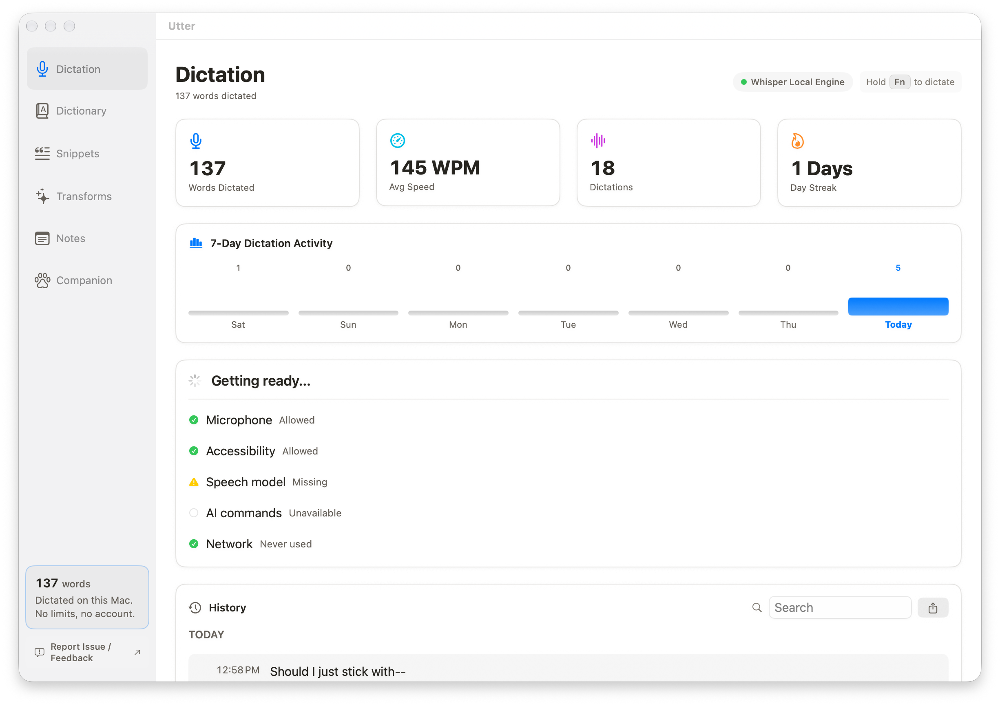
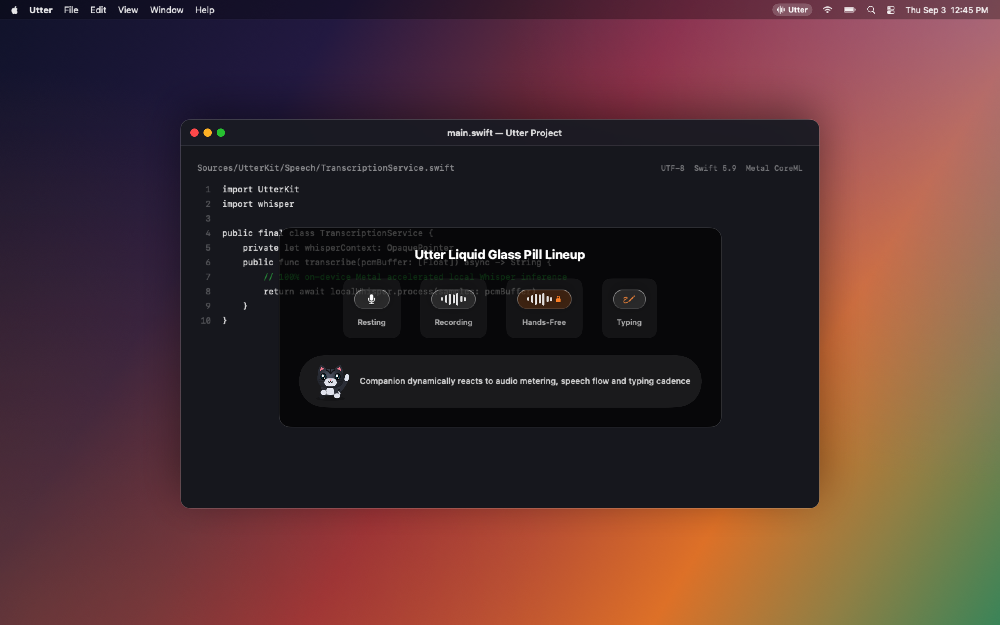
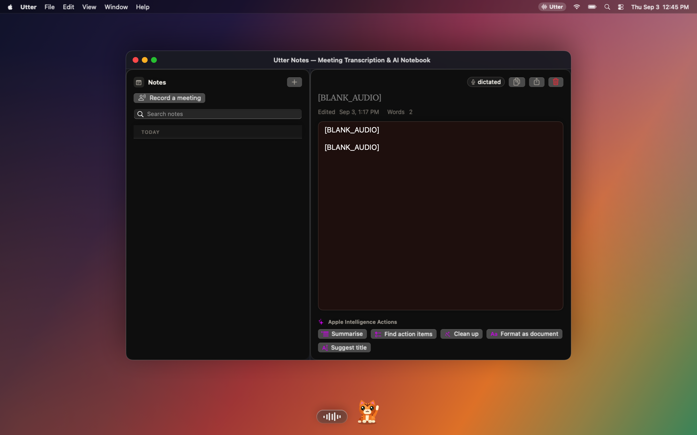
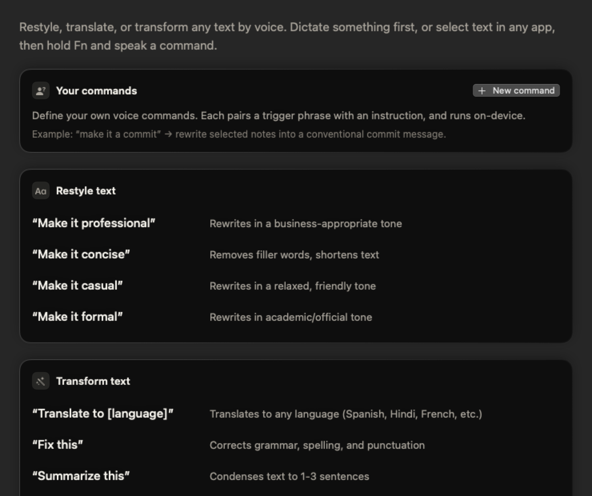
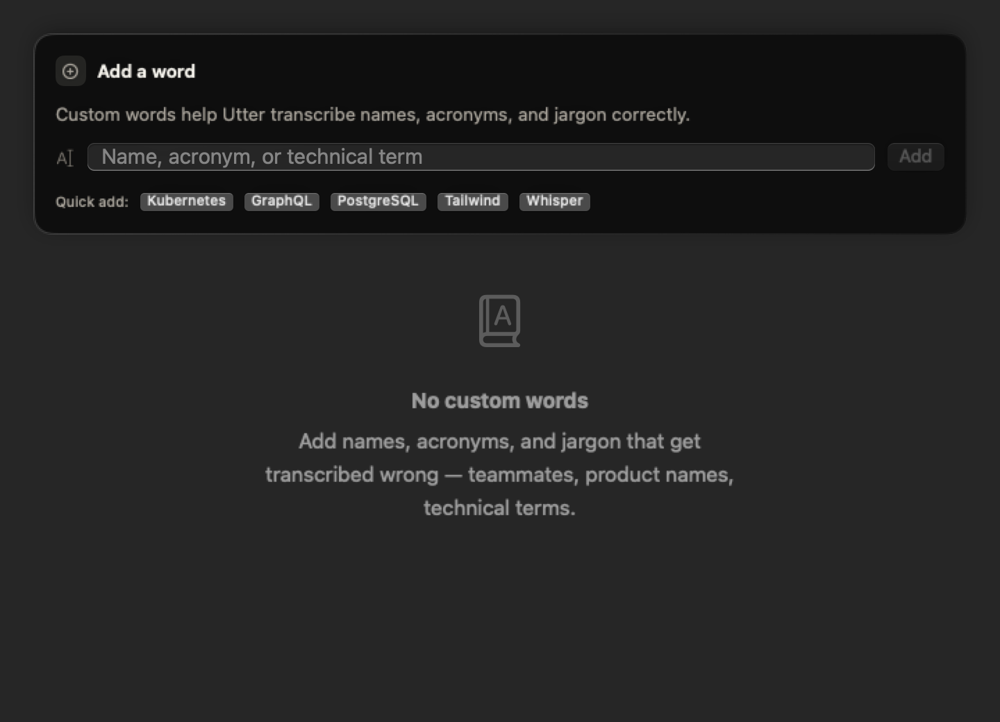
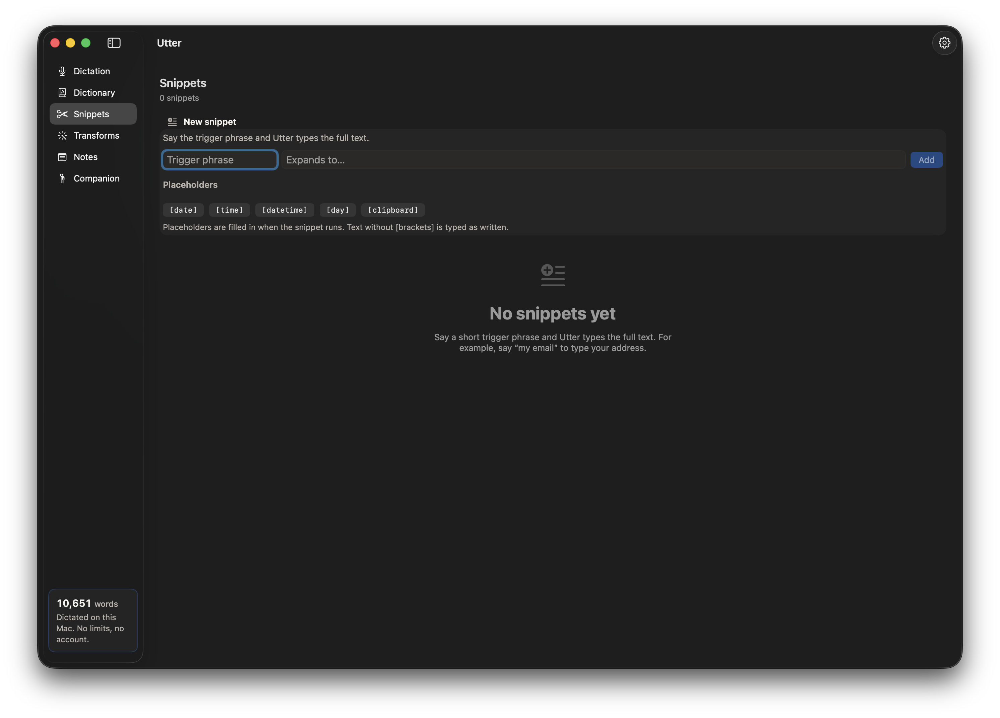
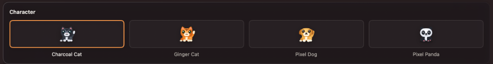
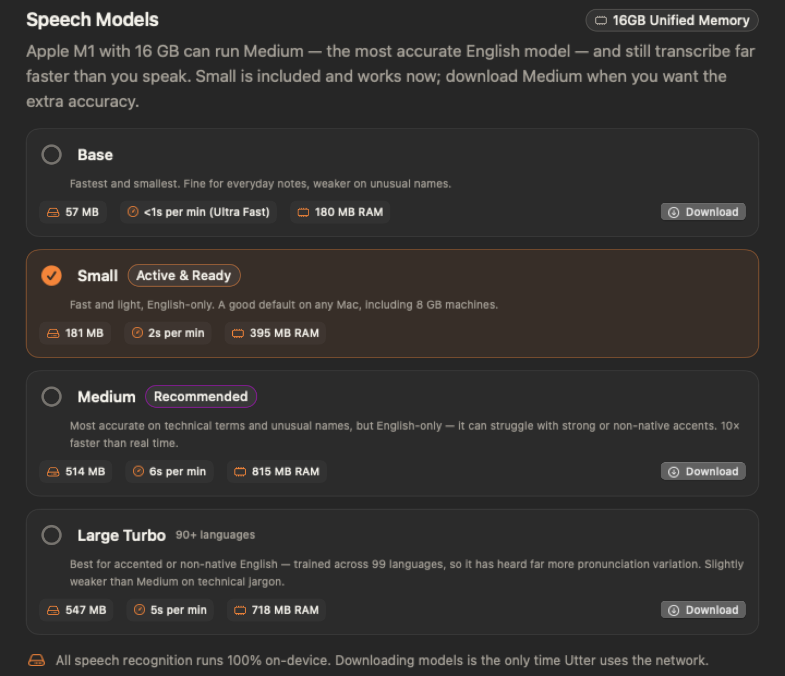
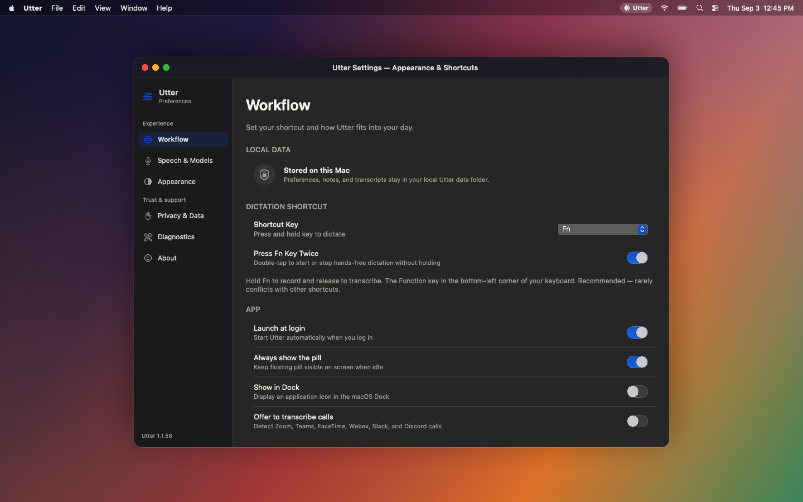
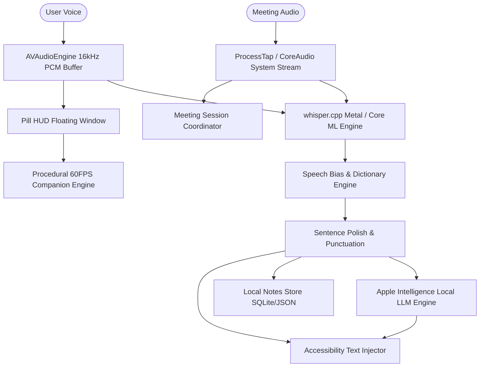

<div align="center">


# Utter

**Private, zero-latency on-device voice dictation for every Mac app.**

[](https://apple.com)
[](https://swift.org)
[](https://github.com/ggerganov/whisper.cpp)
[](https://apple.com)
[](PRIVACY.md)
[](LICENSE)

<br />

<p align="center">
  <a href="https://github.com/h3x-levi/Utter/releases/latest"><b>Download Latest Release (.dmg)</b></a> •
  <a href="https://h3x-levi.github.io/Utter/"><b>Live Web Showcase</b></a> •
  <a href="#quick-start"><b>Quick Start</b></a> •
  <a href="#features"><b>Features</b></a> •
  <a href="#privacy--security"><b>Privacy</b></a> •
  <a href="#building-from-source"><b>Building</b></a>
</p>



</div>

---

## 🌟 Overview

**Utter** is a native macOS application that turns your spoken voice into text wherever your cursor is focused. Hold a keycap, speak naturally, let go — and your words are instantly typed into Mail, Slack, Notes, Xcode, VS Code, Cursor, Obsidian, a terminal, or any active macOS application.

### Why Utter?

Most dictation and voice AI tools stream your audio recordings to remote third-party cloud servers. Utter is engineered with an uncompromising commitment to privacy, speed, and native macOS design:

- 🔒 **100% Local Inference**: Runs `whisper.cpp` in-process with Metal & Core ML hardware acceleration.
- ⚡ **Zero Network Latency**: Zero servers, zero telemetry, zero accounts, zero subscriptions, and zero rate limits.
- 🎯 **Context-Aware Precision**: Automatically adapts capitalization, spacing, and punctuation to code, chat, or long-form prose.
- 🎨 **Liquid Glass Design System**: Built with authentic macOS 13.3–15+ design tokens, vibrant translucency, Bento grids, and 7 bespoke themes.
- 🐾 **Procedural Vector Companions**: Built-in Charcoal Cat, Ginger Cat, Pixel Dog, and Pixel Panda drawn 100% in code (0 PNG assets) with real-time cursor pupil tracking.

---

## ✨ Key Features

### 🎙️ Global Push-to-Talk & Hands-Free Dictation

- **Global Push-to-Talk**: Hold **`Fn`** (or Right **`⌥`**, Right **`⌘`**, Right **`⌃`**), speak your thought, and release. Utter injects clean sentences directly into your active input field.
- **Hands-Free Lock (`⌃⌥Space`)**: Latch recording mode for long-form dictation, brainstorming, or lectures. Auto-settles upon pausing or manual toggle.
- **Fluid Floating Pill**: Non-intrusive HUD capsule with live RMS waveform metering and seamless morphing transitions across 7 distinct states.

<div align="center">
  
</div>

---

### 📝 Note Capture Studio & Meeting Audio Transcription

- **Direct Note Dictation (`⌃⌥N`)**: Stream voice notes directly into Utter's built-in notebook with instant search, speaker separation, and Markdown export.
- **Dual-Stream Meeting Transcription**: Captures microphone input alongside system audio output, transcribing both streams locally as **You** and **Others**.
- **Proactive Meeting Presence Detection**: Automatically detects active meetings across Zoom, Microsoft Teams, Google Meet, FaceTime, Webex, Slack, and Discord.

<div align="center">
  
</div>

---

### 🧠 Apple Intelligence Voice Transforms

- **Voice Transforms**: Highlight any text in any macOS application, trigger Utter, and speak an instruction:
  - *"Make this concise and professional"*
  - *"Fix punctuation and tone"*
  - *"Translate into Japanese"*
  - *"Extract bulleted action items"*
- **On-Device Foundation Models**: Powered locally via macOS `FoundationModels` framework with fallback to offline heuristics or local Ollama instances.
- **Custom AI Commands**: Craft bespoke reusable prompt templates tailored to your personal coding or writing workflow.

<div align="center">
  
</div>

---

### 📚 Custom Vocabulary Boosting & Dynamic Snippets

- **Speech Biasing & Custom Dictionary**: Boost uncommon proper nouns, engineering jargon, medical terms, and project acronyms so Whisper never misses them.
- **Voice Snippets**: Speak trigger keywords to expand complex boilerplate templates with dynamic placeholders (`{date}`, `{time}`, `{clipboard}`).

<div align="center">
  
  
</div>

---

### 🐾 Procedural Vector Desktop Companions

Utter features optional procedural companions drawn 100% in code at runtime ([`CodePixelCat.swift`](Sources/UtterKit/Companion/CodePixelCat.swift)) — zero PNG images are loaded or bundled:

- 🐱 **Charcoal Cat** (`pixel-cat-gray`): Sleek slate-charcoal coat, white chest bib & snout, bright cyan eyes with glossy specular catchlights, and friendly waving paw.
- 🐱 **Ginger Cat** (`pixel-cat-orange`): Warm ginger tabby with orange tiger stripes, white chest bib, sparkling emerald green eyes, and waving paw.
- 🐶 **Pixel Dog** (`dog`): Golden puppy coat, drooping floppy brown ears, cream muzzle, and happy open smile with pink tongue.
- 🐼 **Pixel Panda** (`panda`): White chibi head, round black ears, classic angled black eye patches, black vest & arms, and pink toe bean pads.

<div align="center">
  
</div>

#### Interactive Motions & Physics:
- 👋 **Wave Hello**: Waving front paw greeting with friendly ear twitches.
- 🧶 **Biscuit Kneading**: Sinusoidal arm push gestures on mechanical keypads during dictation.
- 🐾 **4-Leg Walking Cycles**: Articulated quadruped diagonal limb cadence across window bezels.
- 🍞 **Loaf Sleep Mode**: Four limbs tucked cleanly underneath during resting/sleep with peaceful breathing animation.
- 🤔 **Chin-Scratch Thinking**: Arm raised to chin with thoughtful head tilts while evaluating speech tokens.
- 🎉 **Delighted Celebration**: Both paws raised in celebration during fast speech flow and coding streaks.
- 👁️ **Real-Time Cursor Pupil Gaze**: Pupils smoothly track your cursor across any active display in real time.
- 🪂 **Dangle Physics**: Limbs and tail dangle with natural gravity when dragged across displays.
- ⚡ **Sub-Millisecond Draw Calls**: Rendered asynchronously on background CoreGraphics queues at 60 FPS with 0% main-thread CPU overhead.

---

### 🎛️ Speech Model Chooser & Benchmark Selection

Utter bundles the high-accuracy `ggml-small.en-q5_1.bin` model (181MB) for instant out-of-the-box operation and supports downloading specialized multilingual and quantized Whisper models directly within the app (Tiny, Base, Small, Distil-Whisper, Large-v3-Turbo).

<div align="center">
  
</div>

---

### 🎨 7 Liquid Glass Themes

Crafted with pixel-perfect macOS typography, high-contrast borders, and adaptive materials:
1. **System Glass** (Dynamic Auto Light/Dark)
2. **Dark Glass** (Refined Translucent Obsidian)
3. **Obsidian** (Pure Deep Charcoal)
4. **Solar Warmth** (Warm Amber Glow)
5. **Nordic Frost** (Crisp Polar Blue)
6. **Midnight Indigo** (Rich Deep Violet)
7. **Paper White** (Clean Minimalist Editorial)

<div align="center">
  
</div>

---

## 🔒 Privacy & Performance Matrix

| Metric / Feature | Utter | Cloud AI Dictation Apps | System Siri Dictation |
| :--- | :---: | :---: | :---: |
| **Audio Processing Location** | **100% Local (In-Process)** | Cloud Servers | Cloud / Partial Local |
| **Network Traffic** | **0 Bytes Sent** | Continuous Audio Upload | Telemetry & Logs |
| **Offline Operation** | **Full (Airplane Mode)** | Requires Active Internet | Limited |
| **Hardware Acceleration** | **Apple Silicon Metal & Core ML** | Remote GPU Fleet | Apple Neural Engine |
| **Subscription / Pricing** | **Free & Open Source** | $10–$20 / month | Free |
| **Meeting Dual-Stream Capture** | **Included** | Paid Add-on Bot | Unsupported |

---

## ⌨️ Default Keyboard Shortcuts

| Shortcut | Action | Scope |
| :--- | :--- | :--- |
| **`Hold Fn`** *(or `Right ⌥`, `Right ⌘`, `Right ⌃`)* | **Push-to-Talk**: Dictate into active cursor position | Global |
| **`⌃ ⌥ Space`** | **Toggle Hands-Free Mode**: Continuous dictation | Global |
| **`⌃ ⌥ N`** | **Dictate to Notes**: Capture voice into notebook | Global |
| **`⌃ ⌥ U`** | **Open Utter Workspace**: Access settings and history | Global |
| **`Escape`** | Cancel active recording / Dismiss HUD | Global |

---

## 🚀 Quick Start

### 1. Install via Homebrew (Recommended)

```bash
brew install --cask utter
```

### 2. Or Download Directly

Download the latest DMG release from [GitHub Releases](https://github.com/h3x-levi/Utter/releases/latest):
```bash
# Direct download from terminal:
curl -LO https://github.com/h3x-levi/Utter/releases/download/v1.1.56/Utter-1.1.56.dmg
```

1. Double-click `Utter-1.1.56.dmg`.
2. Drag **Utter.app** into your **Applications** folder.
3. Launch **Utter** from Spotlight or Applications.

### 3. Grant macOS Permissions

Upon first launch, Utter will guide you through granting two standard macOS permissions:
- **Microphone**: Required for capturing spoken audio.
- **Accessibility**: Required for detecting your chosen global push-to-talk hotkey and injecting transcribed text into active applications.

---

## 🛠️ Building from Source

### Prerequisites
- macOS 13.3 Ventura or later
- Xcode 15+ or Command Line Tools (`xcode-select --install`)
- Swift 5.9 or later

### Clone & Build
```bash
# 1. Clone repository
git clone https://github.com/h3x-levi/Utter.git
cd Utter

# 2. Build release binary using Swift Package Manager
swift build -c release

# 3. Create styled DMG installer and application bundle
./scripts/build-app.sh --keep-permissions
```
The compiled application and installer will be located in:
- `build/Utter.app`
- `build/Utter-1.1.56.dmg`

---

## 🧩 Architecture



---

## ⚠️ Ported Project Notice & Reporting Issues

> [!NOTE]
> **Utter is a complete bi-ported native macOS application** bringing together high-performance C++ `whisper.cpp` Metal bindings, CoreAudio system taps, and Apple Intelligence FoundationModels inside a unified SwiftUI Liquid Glass architecture.
>
> Because this is a complex ported application, **there might still be occasional edge-case bugs, UI quirks, or hardware-specific lag/latency issues** on particular Mac configurations (Intel vs Apple Silicon M1/M2/M3/M4 or non-standard external audio interfaces).
>
> We actively welcome and appreciate all community feedback, issue reports, and diagnostic logs to help us make Utter rock-solid for everyone!

### 🐛 How to Report Bugs or Performance Issues

If you encounter a crash, audio dropout, UI lag, or unexpected behavior:

1. **Check or Open an Issue**: Visit our [GitHub Issue Tracker](https://github.com/h3x-levi/Utter/issues).
2. **Include Your System Info**:
   - macOS version (e.g. `macOS 14.5 Sonoma` or `macOS 15.0 Sequoia` via `sw_vers`)
   - Mac model (e.g. MacBook Pro M3, MacBook Air M1, Mac Studio M2 Max, Intel iMac)
   - Active input device (Built-in Microphone, AirPods, USB mic, etc.)
3. **Attach Diagnostic Logs**:
   - Open **Utter Settings** (`⌃ ⌥ U` or click the menu bar icon → *Settings*).
   - Go to the **Diagnostics & Telemetry** pane.
   - Click **"Reveal Logs"** to open Utter's local diagnostic reports folder (`~/Library/Logs/DiagnosticReports/` or Utter crash logs).
   - Attach or paste relevant log snippets in your issue description.
4. **Describe the Steps to Reproduce**:
   - What key was pressed (e.g. `Fn`, `⌃⌥Space`)?
   - What application had the active text cursor?
   - What was the expected vs. actual behavior?

---

## 📄 License

Utter is distributed under the **Apache License 2.0**. See [`LICENSE`](LICENSE) for complete terms.

```
Copyright 2026 Utter Contributors

Licensed under the Apache License, Version 2.0 (the "License");
you may not use this file except in compliance with the License.
You may obtain a copy of the License at

    http://www.apache.org/licenses/LICENSE-2.0
```
