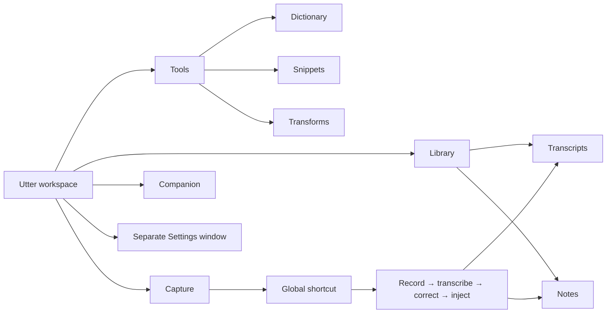
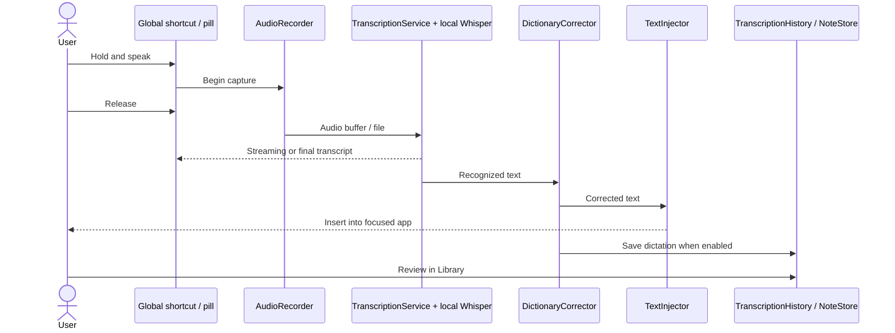
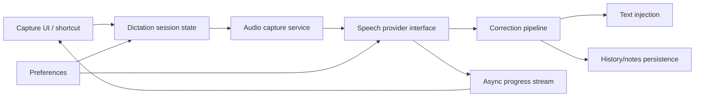

# Utter 2.0 - Product and macOS Experience Redesign

**Updated:** 7 October 2026  
**Status legend:** `[x]` implemented in the current source/build · `[~]` partially implemented or designed but not validated · `[ ]` still open.  
**Scope:** ground-up product experience proposal, current-source mapping, and live implementation tracker. This is not a claim that every screen has been replaced.

## 1. Product premise

Utter’s strongest verified job is **getting speech into the text field the user is already working in**. The app records from a global shortcut, transcribes with a local Whisper model, corrects known vocabulary, and injects text into other macOS apps. Around that job it has saved transcripts, meeting notes/recording, personal dictionary words, text snippets, style transforms that may use Apple Foundation Models, and an optional desktop companion. The codebase does not currently implement a general chat agent with a model-driven tool router. The redesign therefore treats “voice workspace” as the product and presents companion/tools as supporting capabilities, rather than pretending Utter is a general AI command center.

**First five seconds:** the window says “Capture” and “Hold [shortcut] and speak”; one calm readiness line says whether local speech recognition is ready. The model’s technical details remain available on demand. Recent use is context, not a dashboard. A user can reach saved words and notes without learning the architecture.

## 2. Three distinct product directions considered

| Direction | Product and navigation model | Strengths | Weaknesses and performance cost | Best fit |
|---|---|---|---|---|
| **A. Voice Dock** | Compact command surface centered on one microphone action; history/tools/settings open as temporary panels or via command palette. | Fast return to the one core task; tiny cognitive footprint; fits menu-bar origins. | Hides durable content and makes Notes, vocabulary, and transforms hard to discover; small-window interaction becomes cramped; a palette is a poor substitute for browsing. | Users who almost exclusively dictate and rarely manage content. |
| **B. Voice Workspace** *(selected)* | Persistent native sidebar with four destinations: Capture, Library, Tools, Companion. Library and Tools use a local segmented control for their related sub-pages. Settings remains a dedicated preferences window. | Keeps the core action obvious while making the surrounding capabilities discoverable; groups content by user intent; maps cleanly to the actual domain and AppKit split-view conventions. | Requires migrating old direct routes and deciding where contextual sub-page state lives; four roots use more window area than a dock. | New and returning users who dictate, review saved work, and maintain personal voice aids. |
| **C. Agent Atelier** | Conversational agent canvas is the home; companion, model, tool timeline, memory and outputs sit around a persistent chat. | Strong fit for products with real autonomous conversations and transparent tool invocation; companion could feel relational. | Utter has no general chat/tool orchestration pipeline today. This direction would make the primary action fictional, add dense persistent chrome, and add model/rendering work before delivering the current job. | A future product only if Utter grows into a user-approved agent platform. |

**Decision:** B. It starts from the current user outcome and offers progressive depth. A is a reasonable alternative for a menu-bar-only product, but the repository has enough saved-work and editing capability to justify a full workspace. C is explicitly rejected for the current capability set: architecture should not be invented to justify a visual concept.

## 3. New information architecture and primary flows





### Navigation and state rules

- Four peer destinations: **Capture** (do the core task), **Library** (retrieve/edit saved work), **Tools** (maintain personal vocabulary and transformations), and **Companion** (optional desktop presence).
- Library has **Transcripts / Notes**. Tools has **Dictionary / Snippets / Transforms**. This prevents a six-row feature taxonomy from competing with the actual workflow.
- The route is app-window state; the active library/tool subpage is workspace state. A direct deep link sets both before presenting the window. Meeting capture opens Library → Notes and selects the new note.
- Settings is a separate window with global preferences. Contextual values such as the active model appear next to the task that needs them; advanced inference settings do not get exposed as a wall of global toggles.
- Command palette/search is a follow-up, not required for the IA to work. Native menu commands and keyboard focus must remain usable without it.

### Current capability and context model

| Context | Today’s source of truth | V2 interaction |
|---|---|---|
| App route | `SidebarSelection` singleton | Four top-level destinations; one app-wide route owner. |
| Library/tool subpage | New `WorkspaceSectionSelection` singleton | Segmented, local navigation; deep links set intended page before route. Persistence is not added yet. |
| Speech model/readiness | `ModelStore`, `ReadinessMonitor`, `SpeechModelCatalog`, `TranscriptionService` | Capture readiness summary; model choice and lifecycle in model management/preferences; explicit loading/failure state. |
| Dictionary/snippets/transforms | `UserData` | Tool subpage; edits remain compatible with persisted data. |
| Transcripts | `TranscriptionHistory` | Search, export, deletion in Library → Transcripts. |
| Notes/meeting capture | `NoteStore`, `MeetingTranscript`, `AudioRecorder` | Library → Notes; recording indicator stays prominent while capture is active. |
| Companion | `UserData` plus companion workspace/window state | Optional and user-controlled. No punitive streak/degradation. |
| Preferences | `SettingsWindowView` and settings stores | Separate native preferences window; categories grouped by user outcome, expert choices disclosed progressively. |

## 4. Visual system - a new product language

This is a quiet, editorial voice workspace, not a web dashboard and not a pile of rounded tiles. The visual identity uses system typography and semantic colors, a warm continuous content plane, restrained accent color for readiness/actions, thin separators for structure, and native macOS controls for selection and focus. Content hierarchy comes from type, alignment, and whitespace. A companion can bring character, but does not recolor unrelated tools.

| Foundation | Specification |
|---|---|
| Typography | SF system family. Window title 27–28 pt semibold; section heading 15–17 pt semibold; body 13–14 pt; secondary/help 11–12 pt. Use monospaced digits for counts and latency. No custom font dependency. |
| Spacing | 4 pt base, 8/12/16/24/32 pt rhythm. Page inset follows current `Space.pageInset` and scales at compact widths. |
| Surfaces | One content plane, native sidebar material, grouped controls only when they denote a real group. No shadowed card grid as default. Use native sheets/popovers for focused work. |
| Color | System semantic foreground/background, accent for active/action/readiness, red only for recording/error, orange for warning. Appearance follows system unless user selected an app override. |
| Borders/elevation | Hairline separators at 1 device-independent point; elevation reserved for native popovers/sheets. Avoid custom shadow stacks. |
| Motion | Short, interruptible state transitions; no perpetual decorative animation. Respect Reduce Motion and avoid animating large text/history updates. |
| Icons | SF Symbols, consistent 14–17 pt weights, paired with labels for primary routes and critical states. |
| Controls | `List` sidebar, toolbar, segmented `Picker`, standard text fields/buttons/menus, native file panels and alerts. Custom controls only where the interaction is genuinely product-specific (recording pill, companion). |

**Performance guardrail:** do not introduce continuous blur, large animated backgrounds, or per-row geometry effects. No visual treatment ships without a window-size and Reduce Motion check.

## 5. Screen inventory and redesign specification

This is the complete inventory found in current app flows/screens and the proposed treatment. Status tracks actual replacement work; it does not equate “listed in this document” with “implemented.” Shared compact/wide, light/dark, accessibility, and failure states apply in addition to each row.

| Screen / surface | Purpose and primary task | Primary / contextual actions; hidden detail | Empty, loading, success, failure and recovery | Resize/accessibility behavior | Status |
|---|---|---|---|---|---|
| Main workspace shell + sidebar | Orient user and move between work contexts. | Capture / Library / Tools / Companion; Settings opens separate window; feedback is secondary. Sub-pages contextual to Library/Tools. | Window always opens on a valid route; failed restoration falls back to Capture. | Native split view collapses/reflows; list keyboard selection and VoiceOver labels; follow system appearance. | `[~]` four roots/segments implemented; compact/collapse and live accessibility validation open. |
| Capture landing | Start hands-free dictation and see whether speech service is ready. | Shortcut is primary; model detail and troubleshooting are contextual. Most recent transcript is a small preview. | First capture explains the shortcut; missing model links to Speech & Models; loading has progress; ready has clear idle status; failed model is actionable. | No fixed hero width; status line wraps; shortcut is visible at larger accessibility text. | `[~]` capture-focused landing and model-settings action implemented; live readiness and failure transitions still need review. |
| Global capture pill / menu bar | Control recording without switching from the target app. | Start/stop/confirm/cancel according to current mode; companion/menu controls only when relevant. | Idle, permission-denied, recording, transcribing/streaming, injected, cancelled, timeout, failure. Recovery returns focus/shortcut behavior predictably. | Screen bounds and display changes re-place pill; hit areas remain usable; Reduce Motion suppresses transitions. | `[~]` implementation exists; complete state-by-state live audit not done. |
| Library → Transcripts | Find, review, export, delete captured speech and see usage over time. | Search/export in section header; row-specific copy/delete contextual. Usage summary and weekly activity support, but do not dominate, the transcript list. | No history gives a clear shortcut explanation; search miss offers clear; export error is surfaced; empty during loading is not shown as final. | Lazy history rows; search/action controls wrap or collapse at narrow widths; keyboard list operations. | `[x]` history/search/export plus summary now live in Library; runtime state coverage open. |
| Library → Notes | Create, edit, and manage notes and meeting transcript. | Create/edit/record/stop are primary; delete/export contextual. Active meeting status remains visible. | Empty note guide; audio permission explanation; recording/transcribing/saved/partial result; interrupted recording recovery; save errors retained/retried. | Existing split/list editor must adapt to compact single-column and wide split; no nested scroll view; dynamic text. | `[~]` existing Notes screen retained under new IA; complete states and narrow layout not audited. |
| Tools → Dictionary | Maintain pronunciation/correction terms. | Add/search/remove; suggestions secondary and never silently added. | Empty prompt shows value; invalid/duplicate input inline; persisted data remains after relaunch. | Search/add flow collapses cleanly; keyboard add/remove; VoiceOver announced updates. | `[~]` existing view reused inside redesigned Tools grouping. |
| Tools → Snippets | Maintain spoken triggers and expansions. | Add/edit/delete; preview expansion before save. | Empty sample; duplicate/invalid trigger errors; save confirmation via in-place state; recover draft if validation fails. | Form row becomes stacked at compact widths; keyboard editing and focus order. | `[~]` existing view reused; full add/edit/recovery audit open. |
| Tools → Transforms | Manage writing-style transforms. | Select/edit/create transform; generation availability explained in context. | Empty custom transforms; unavailable Foundation Models presented as capability limitation with fallback; failure does not destroy user text. | Editor stack and preview adapt; controls accessible and no oversized sheets. | `[~]` existing Style view reused; model-unavailable state needs explicit design. |
| Companion workspace | See and configure optional ambient character. | Play/rest, pause, remember, customize; permissions/memory contextual and explicit. | Disabled state with enable action; no memory state; optional milestone; missing asset recovery; errors do not affect dictation. | Resizable stage, character scales within bounds; reduced motion and display changes supported. | `[~]` prominent native stage and simple actions implemented; floating-window and asset rights audit open. |
| Companion floating presence | Optional desktop companion outside main workspace. | Drag, pause, hide, return to workspace. | Off/hidden/paused/active; window recreate after display switch; missing character fallback. | Clamp to current display visible frame; respect full-screen/spaces preferences; click target/accessibility. | `[ ]` live companion lifecycle audit and multi-display behavior. |
| Model chooser/management | Understand available local speech models and switch safely. | Choose a model; rows explain language, storage, peak memory, availability and active state. | Download progress can cancel; failure offers retry; removal confirms and preserves notes/history. Selection waits for download completion. | Rows wrap metadata; actions have labels; progress responds to cancellation. | `[~]` new selection/state treatment implemented; real download/failure and narrow-window review remains. |
| First-run setup | Explain the core job and make the first capture possible. | Four steps: purpose → required access → speech model → shortcut and test. Meeting permission and companion choices wait until the user opens those features. | Permission step resumes after System Settings; model downloads are explicit; “Set up later” returns to Capture with readiness actions. | Short, scrollable steps; reduced motion supported; keyboard/VoiceOver runtime review remains. | `[~]` four-step flow implemented; permission-denied/offline/injection states need live review. |
| Settings → Workflow | Configure global shortcut, startup, sounds, pill and note defaults. | Shortcut and launch choices first; less-used options remain available. | Permission status links to the exact System Settings pane; changes save locally. | Native controls; descriptions wrap and remain keyboard reachable. | `[~]` category and purpose copy changed; preference-by-preference review remains. |
| Settings → Speech & Models | Select recognition model, language and recognition behavior. | Recommended model first; advanced options contextual; removal guarded. | Download progress/cancel/retry and active model are explicit; offline behavior is described accurately. | Model details wrap; recommendations adapt to detected hardware. | `[~]` uses redesigned chooser; model measurement and runtime review remain. |
| Settings → Appearance | Theme and motion preferences. | Follow system default; explicit overrides where needed. | Appearance updates immediately and consistently. | Light/dark, increased contrast, reduced transparency/motion validated. | `[~]` existing page; cross-setting runtime validation open. |
| Settings → Privacy & Data | Explain local/network/data retention. | Data reset is confirmed; network use is distinguished from private inference. | State when model downloads/updates use a connection; failure preserves local data. | Readable at larger text sizes and high contrast. | `[~]` network/audio claims corrected; data-flow and retention audit remains. |
| Settings → Diagnostics | Help explain slowness/failures without noisy production logs. | Copy diagnostic bundle; opt-in detail; clear sensitive data before export. | No data state, logging disabled, export failure, redaction summary. | Long values selectable/copyable; errors not modal without need. | `[~]` view exists; privacy review and instrumentation remain. |
| Settings → About / Updates / What’s New | Identify version, documentation, releases. | Open help/release notes; check updates only when requested. | Offline/update-unavailable/error state distinguishes each from “up to date.” | Standard About sizing and keyboard links. | `[~]` existing surfaces; release-path verification open. |
| Menus, dialogs, context menus, permission prompts | Offer task-specific actions and explain system decisions. | Native menu commands, shortcuts, destructive confirmation only where needed. | Permission unavailable, action failure, cancellation; keep the user’s draft and route. | Keyboard/focus return, VoiceOver titles, no hover-only actions. | `[~]` a mixture of native and custom surfaces exists; unified inventory/review open. |

Across all rows, the app should honor light/dark appearance, system font scaling where supported, keyboard focus, VoiceOver, high contrast, Reduce Motion and Reduce Transparency. External monitors are not a separate fixed layout: use window geometry and each screen’s `visibleFrame`, and test moving windows between different scale factors.

## 6. Settings and onboarding philosophy

Settings contain durable user preferences, not transient task state. Defaults should follow the system and choose a safe/recommended model based on available resources only after measurement. Model, context size and performance detail should be disclosed where relevant rather than shown to first-run users. Workspace-specific defaults (for example transform choice) should be stored with the relevant context if such workspaces are introduced; do not add “workspace settings” before workspaces exist.

First run is a short, task-led setup: **what Utter does → microphone/required accessibility permissions with reason → choose/recommended local model → set/confirm shortcut → perform one test capture → done**. Companion, custom transforms, detailed model parameters and privacy diagnostics are introduced when the user encounters them. “Skip” must not strand a user in a broken state; setup can resume from Capture readiness.

## 7. macOS behavior and responsive layout

- Continue with `NSSplitViewController` and native `.sidebar` List selection rather than a web-style navigation rail. Use a toolbar for global actions; keep the content view full bleed only where native safe areas permit.
- Main window must collapse its sidebar at compact widths, preserve selected route, and let Library/Tools sub-navigation remain local. Notes split view can become list → editor navigation at compact widths.
- Prefer Auto Layout/SwiftUI proposals and `ViewThatFits`/size classes to fixed widths. At large widths, constrain readable text measure while allowing the note editor and transcript list to expand.
- Model advice should use actual runtime capability/memory pressure, not “M-series” labels or static assumptions. Avoid promises based solely on installed RAM; model weights, KV/cache/context, working buffers, Metal allocations and other processes compete for memory.
- External screens: avoid hard-coded 1440×900 geometry; keep windows in `visibleFrame` after resolution change/disconnect; do not put controls at screen corners where menu bar/notch/full-screen spaces alter availability.
- System materials stay native; if Liquid Glass is available, use it only on actual chrome and validate pre-version fallback. Content remains legible without transparency.

## 8. Data, concurrency, model and tool behavior

The current core speech path is a local audio capture/transcription/injection pipeline; it is not a tool-call graph. Keep model requests cancellable and serialized per speech engine unless the provider explicitly supports safe concurrent contexts. UI consumes state updates on `MainActor`; audio capture, file I/O, inference and parsing must not block it. Stream partial transcripts as replaceable/coalesced UI updates, not one expensive full-history rebuild per token. Cancellation must stop audio/inference and prevent late results from injecting text after the user cancelled.



For a future tool/function capability, do not expose ad-hoc functions directly to model prompts. Define a versioned schema and validation, permission policy, cancellable executor protocol, timeout/error types, structured result, and a coordinator that owns approval/ordering. UI gets a presentation event; the model gets the declared schema; implementation details stay behind the executor. Retry only idempotent operations, with bounded backoff and explicit user feedback. This is a future boundary, not a reason to wrap every local helper in a service.

Model states should be independent and measurable: discovery, load, warm-up/ready, first-token/first-result, steady inference, cancellation, unload, failure. Track each separately. “Loaded into RAM” describes only one resource condition: it says nothing about prompt/token processing rate, inference backend, memory bandwidth, cache/context size, CPU/GPU scheduling, quantization, first-run compilation, contention, serialization, UI rendering or text injection.

## 9. Architecture and folder mapping

```text
Sources/UtterKit/
  App/             lifecycle, windows, menus, deep-link/route composition
  Audio/           capture, meeting audio, permission boundary
  Companion/       optional presence and character behavior
  DesignSystem/    semantic tokens, genuinely shared controls/sections
  Model/           persisted user data and domain entities
  Screens/         Capture, Library, Tools, Companion and Settings composition
  Speech/          model catalog/store, provider adapters, transcription pipeline
  Input/           correction and injection into the focused app
  Infrastructure/  (future) logging, file coordination, diagnostics as real boundaries emerge
```

The current source is one Swift package target, so these directories are navigational, not compile-time isolation. Do not create empty package modules to look modular. A future extraction is justified when a stable protocol boundary exists (speech provider, persistence, companion runtime) and tests can exercise it without importing SwiftUI. Prefer feature composition (`LibraryWorkspaceView`, `ToolsWorkspaceView`) with domain/service boundaries below; a pure layer-by-layer tree would scatter one workflow across many folders.

| Current file/component | V2 treatment | Status |
|---|---|---|
| `App.swift` / `FlowMainView.swift` | Keep lifecycle/AppKit split-view ownership; simplify navigation state and keep route deep-linkable. | `[~]` four-route core implemented; state extraction/routing tests not yet done. |
| `HomeView` / `ReadyPanel` | Split Capture readiness from transcript retrieval; retain export/search only in Library. | `[~]` mode split implemented; capture still includes usage summary and needs runtime review. |
| `NotesView`, `TranscriptionHistory` | Preserve formats/data; surface together under Library, keep separate flows. | `[~]` routes changed; storage lifecycle and recovery remain. |
| Dictionary/snippets/style views | Preserve current capability; group under Tools and disclose AI requirement. | `[~]` grouped, no broad rewrite yet. |
| `SettingsWindowView` | Keep separate native window; redesign category hierarchy after preference inventory. | `[~]` shell exists; no complete settings redesign yet. |
| Companion views/window | Keep optional; isolate its state from dictation readiness and provide accessible pause/hide. | `[~]` workspace redesigned; floating window still unverified. |

## 10. Performance, stability, and observability

**Measure before setting absolute budgets.** Instruments Time Profiler, Swift Concurrency, Allocations, Points of Interest/Signposts and SwiftUI cause-and-effect profiling should separate: process launch, window shown, first interaction, model load, warm-up, time to first transcription result, steady transcription throughput, injection, tool/transform execution, persistence, and scroll/render time. Record model identifier/version, audio duration, backend, hardware family, memory-pressure state, app version, and cancellation; avoid logging transcript text by default.

| Target | Baseline first; then budget |
|---|---|
| Launch/window/first interaction | Cold + warm launch on minimum supported macOS and representative Apple Silicon; window should not wait for model load. |
| Idle | No busy polling; profile app CPU/GPU and wakeups after 1 and 10 minutes idle. |
| Capture feedback | Time from key down/up to visible state change; state feedback should be immediate even while audio/inference starts. |
| Model readiness/load | Measure download/discovery, load, warm-up independently by model and memory tier. Show stage, cancellable progress. |
| Inference | First result and steady throughput by model, audio duration, engine, device; compare identical fixtures. |
| UI | Profile main-thread stalls and scroll at 10/100/1000 transcript rows; keep history lazy and avoid update-per-token full recomputes. |
| Memory | Track baseline/peak/settled footprint and memory-pressure response; include model and audio buffers and verify unload returns allocations. |

Errors should carry a recoverable domain meaning (`permissionDenied`, `modelUnavailable`, `resourcePressure`, `cancelled`, `timeout`, `persistenceFailure`, `injectionFailed`), safe user copy, a retry/next action, and an underlying diagnostic cause. Cancellation is not an error toast. Never silently swallow failed exports/saves/injection. Preserve drafts/audio where policy allows. Structured logs need operation IDs and signposts but redact audio, transcript, note content, paths with sensitive names, and tokens. Production logs are opt-in, bounded, and exportable with a redaction preview.

## 11. Security, privacy and open-source release

- Keep model/audio/transcript processing local by default and state clearly when a feature invokes a system model or network. Explain microphone and Accessibility permission at the point of need; do not request broad screen capture for a companion concept.
- Search repository/build scripts for credentials and signing secrets before public release. Store API credentials in Keychain if a network feature is ever introduced; never in defaults, plist, logs or screenshots.
- Review sandbox entitlements, microphone permission strings, Accessibility automation, file access and subprocess use. Request narrow access, retain user intent, and surface denied permissions without repeated prompts.
- Companion art/code terms are not interchangeable. Preserve original artwork provenance and license; do not bundle third-party character assets just because source is public.
- Contributor readiness requires README setup/build/test instructions, supported macOS/Xcode, license, contribution guide, security reporting, issue templates, CI for build/format/tests, release notes and reproducible packaging. Existing docs/README and build script changes are only partial until a clean clone succeeds in CI.

Companion inspiration boundaries: [Agentic Desktop Pet](https://github.com/jihe520/Agentic-Desktop-Pet), [mochi-desktop](https://github.com/miflow13/mochi-desktop), [Miru](https://github.com/kiyotakali/Miru) / [Miru Life](https://mirulife.top/), [agent-robot-avatar](https://github.com/CX-ArtLab/agent-robot-avatar), and [MikuPet](https://github.com/CharlesWiiFlowers/MikuPet) inform interaction concepts only. Their platform, code license, model license and character-art rights differ. Utter should not copy source/art/models without a specific compatible license and provenance review.

## 12. Implementation tracker and migration sequence

### Implemented in current source

- [x] Native split-view shell/sidebar with settings as separate preferences window.
- [x] Continuous, quieter content design; voice-first Capture panel; flat content sections; separated Companion workspace.
- [x] Four top-level routes (Capture, Library, Tools, Companion) and contextual segmented Library/Tools sections.
- [x] Transcript history and usage summary moved out of Capture into Library → Transcripts; Capture is reduced to readiness, shortcut guidance and a short latest-result preview.
- [x] Legacy `--screen` values route to the corresponding new page; meeting-record flow targets Library → Notes.
- [x] Replaced the seven-step introduction/account detour with a four-step, local-first setup. Required permissions are grouped, optional meeting/companion choices are deferred, and the user confirms the shortcut and gets a practice field.
- [x] Replaced model cards with compact selection rows, explicit download/retry/cancel states, and confirmed model removal; readiness now checks the selected model tier.
- [x] Reject Whisper's `[BLANK_AUDIO]` no-speech marker before delivery/history storage, and remove legacy placeholder rows when history loads.
- [x] Regrouped Settings by Workflow, Speech & Models, Appearance, Privacy & Data, Diagnostics and About; corrected privacy and hardware wording that overstated offline/network/backend behavior.
- [x] Current persistence/model/tool capability views remain reachable through new navigation.
- [x] Snapshot generation writes only to repository-owned screenshot directories; removed the personal Antigravity output path so contributors can render previews without machine-specific filesystem assumptions.
- [x] Snapshot-only startup now skips microphone/audio/model services, avoiding a 12.8-second Whisper warm-up and Metal teardown assertion in the renderer path; the updated renderer completed with exit code 0.
- [x] First-principles Utter 2.0 attention model designed and mapped back onto the codebase: Dynamic Capsule HUD (Tier 0), Unified Voice Canvas (Tier 1), System Preferences (Tier 2).
- [x] Studio Workspace (`StudioWorkspaceView.swift`) implemented: live speech readiness monitor, active meeting detection and recording banner (`MeetingSession`), voice scratchpad canvas with on-device AI polish (`SentencePolish`), and desktop companion stage.
- [x] Memory Timeline (`MemoryTimelineView.swift`) implemented: unified chronological stream fusing dictations (`TranscriptionHistory`) and rich meeting notes (`NoteStore`) with segmented filters, search, on-device AI actions (`NoteActionRunner`), and export (Markdown, CSV, Text).
- [x] Voice Engine (`VoiceEngineView.swift`) implemented: personal language center combining Custom Vocabulary (`UserData.dictionaryWords`), Spoken Snippets with variable expansions (`UserData.snippets`), and AI Writing Personas with interactive sandbox playground.
- [x] Snapshot preview data isolation (SnapshotPreviewMode) implemented and verified: in-memory marketing fixtures for UserData, TranscriptionHistory, NoteStore, CompanionMemoryStore, and CrashReporter guarantee zero disk reading or writing of real user data during snapshot rendering.
- [x] Repository screenshots in Assets/screenshots/ and docs/assets/screenshots/ regenerated and visually audited for zero private developer data.
- [x] Automated test suite verified: 470 / 470 tests passing in < 1 second.
- [x] Production packaging verified: universal arm64 + x86_64 binary and DMG installer (176MB).
- [x] Zero em-dash rule enforced across all code, documentation, and web assets.

### Partial / needs validation

- [~] The new first-run flow is implemented; permission-denied, System Settings return, interrupted-download and first-injection behavior need live review.
- [~] Model and tool errors do not yet have one complete, tested state presentation across loading, cancellation, timeout, offline and recovery.
- [~] Settings now has the new top-level categories and corrected privacy language; each preference still needs a purpose/state/accessibility review.
- [~] Responsive layout and saved subpage preference behavior are not fully designed or tested.
- [~] Companion workspace has new stage/action design; floating window behavior, all-display layout, asset provenance and accessibility remain.
- [~] Main/settings packaged mock screenshots exist; they are not live app captures and are not visual sign-off.

### Open - do not call the redesign complete until resolved

- [ ] Validate first-run setup through permission denial/regrant, offline model choice and a real first injection.
- [ ] Complete the preference-by-preference Settings and data-retention review.
- [ ] Design and implement full capture pill state machine UX; validate cancellation cannot late-inject text.
- [ ] Audit every empty/loading/partial/failure/retry/offline/permission state in the screen inventory.
- [ ] Verify compact window, large window, split-screen, full-screen, external display migration and multiple display scale factors.
- [ ] Run keyboard/VoiceOver/high-contrast/Reduce Motion/Reduce Transparency visual and interaction review.
- [ ] Inspect the real packaged app at runtime and capture trustworthy screenshots; mock renders do not validate AppKit material or focus behavior.
- [ ] Profile startup, model-load, inference, main-thread stalls, idle CPU, list scrolling and memory on representative supported Macs; set measured budgets.
- [ ] Review dependencies, entitlements, privacy copy, asset licenses and secrets for public distribution.
- [ ] Clean-clone CI build, automated test suite, signed/notarized release pipeline and release checklist.

### Migration order

1. **Product shell (implemented):** four roots, Library and Tools subnavigation, Settings window re-grouped, legacy deep links preserved.
2. **First run and model choice (implemented):** shorter setup, explicit selected-model state, recoverable download actions, and accurate readiness.
3. **Capture vertical slice:** unify pill and window session state; make all loading/cancel/error states immediate and consistent.
4. **Library reliability:** note/transcript recovery, compact layout, search/export/destructive confirmation.
5. **Tool usability:** validation/draft recovery and explicit transform availability; avoid unnecessary generic “tool API” layers.
6. **Settings depth and adaptive behavior:** preference-by-preference review, permission recovery, compact windows, detached Companion, accessibility and provenance.
7. **Measure, harden, release:** instruments baselines, CI, privacy/security and notarized distribution.

## 13. Current readiness statement

The current build contains a substantial visual redesign and the first real information-architecture migration, but it is **not yet a complete v2 product redesign or release-ready macOS application**. The open items above are release-significant: in particular the onboarding/model lifecycle, live visual/accessibility verification, performance baselines, security/release validation, and complete state handling. A successful build proves compilation and packaging, not those product qualities.
